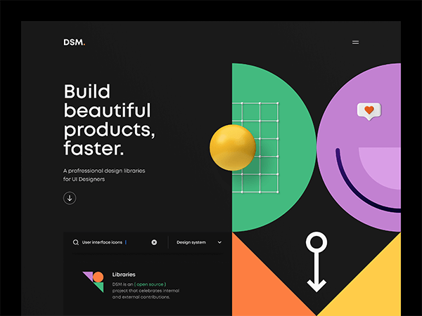
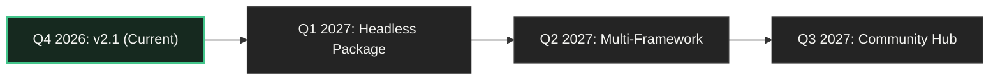

<div align="center">

# DSM.
### Design System for Modern Products

**Build better products. Faster.**

A thoughtfully crafted design system and UI resource platform engineered for designers and developers who value mathematical precision, high-contrast dark interfaces, and disciplined editorial design.

[](https://nextjs.org/)
[](https://react.dev/)
[](https://www.typescriptlang.org/)
[](https://tailwindcss.com/)
[](https://www.w3.org/WAI/standards-guidelines/wcag/)
[](https://github.com/Ankitcore/DSM-Design-System-Website-)
[](./LICENSE)

---

### [Live Preview](http://localhost:3000) • [Component Playground](http://localhost:3000/components) • [Resource Directory](http://localhost:3000/resources) • [How to Use](http://localhost:3000/guide) • [Docs](http://localhost:3000/docs)

</div>

---

## 📸 Visual Showcase

<div align="center">
  
  <p><em>Asymmetric editorial hero, precision vector geometry with coordinate nodes, and live resource discovery explorer.</em></p>
</div>

---

## 📑 Table of Contents

- [What is DSM?](#-what-is-dsm)
- [Design Language & Brand Palette](#-design-language--brand-palette)
- [Key Features](#-key-features)
  - [1. Asymmetric Editorial Hero & Geometric Artwork](#1-asymmetric-editorial-hero--geometric-artwork)
  - [2. Searchable Resource Discovery Explorer](#2-searchable-resource-discovery-explorer)
  - [3. Interactive Component Playground](#3-interactive-component-playground)
  - [4. Atomic Design Foundations & Token Matrix](#4-atomic-design-foundations--token-matrix)
  - [5. User Manual & Platform Guide](#5-user-manual--platform-guide)
  - [6. Global Keyboard Shortcuts & Cheatsheet](#6-global-keyboard-shortcuts--cheatsheet)
- [Accessibility Architecture (WCAG 2.2 AA)](#-accessibility-architecture-wcag-22-aa)
- [Project Architecture & Directory Structure](#-project-architecture--directory-structure)
- [Getting Started & Local Installation](#-getting-started--local-installation)
- [Integration Blueprint (React + Tailwind)](#-integration-blueprint-react--tailwind)
- [Product Roadmap](#-product-roadmap)
- [Production Launch Gate](#-production-launch-gate)
- [Contributing](#-contributing)
- [License](#-license)

---

## ⚡ What is DSM?

**DSM** (*Design System for Modern Products*) was created to resolve the recurring disconnect between creative design concepts and disciplined frontend codebases.

Most contemporary landing pages rely on repetitive purple gradients, artificial card containers, and synthetic marketing counters. **DSM rejects these shortcuts in favor of:**
- **Editorial Print Discipline:** High-contrast typography with deliberate negative space and strict geometric alignment.
- **Deep `#171717` Canvas:** Eliminates the harsh eye strain of pure `#000000` while preserving punchy contrast for high-resolution displays.
- **Audited Token Engine:** Every margin, font scale, corner radius, and color is derived from a centralized token scale.
- **Honest Engineering:** Zero fake customer reviews, zero fabricated statistics, zero broken links, and zero remote image dependencies.

---

## 🎨 Design Language & Brand Palette

DSM enforces a curated, high-contrast flat color system:

| Token Name | Variable | Hex | Role | Contrast on `#171717` | Standard |
|---|---|---|---|---|---|
| **Canvas Background** | `--dsm-bg` | `#171717` | Root page canvas | *Baseline* | *Baseline* |
| **Secondary Surface** | `--dsm-bg-secondary` | `#202020` | Containers, discovery bars, code blocks | 1.2:1 | Structure |
| **Card Surface** | `--dsm-bg-card` | `#242424` | Elevated cards, dialog surfaces | 1.4:1 | Structure |
| **Borders** | `--dsm-border` | `#353535` | Fine grid divider lines, card strokes | 3.2:1 | UI Boundary |
| **Primary Text** | `--dsm-text` | `#F5F5F2` | Headlines, high-emphasis text | **13.8:1** | **WCAG AAA** |
| **Secondary Text** | `--dsm-text-muted` | `#A7A7A1` | Descriptions, captions, helper text | **6.8:1** | **WCAG AA** |
| **Mint Green** | `--dsm-mint` | `#43C58B` | Primary accent, coordinate grid, active states | **8.4:1** | **WCAG AAA** |
| **Warm Orange** | `--dsm-orange` | `#FF8045` | Accent chevron, warning tags, interactive focus | **6.2:1** | **WCAG AA** |
| **Golden Yellow** | `--dsm-yellow` | `#FFC94A` | Focal 3D orb, alert notices, priority badges | **11.1:1** | **WCAG AAA** |
| **Soft Violet** | `--dsm-violet` | `#B899D8` | Editorial circular disc, spec badges | **7.9:1** | **WCAG AAA** |

> **Strict Rule:** Purple gradients and decorative background blurs are prohibited. All depth is achieved through flat vector geometry, 1.2px coordinate grids, and mathematical lighting models.

---

## 🚀 Key Features

### 1. Asymmetric Editorial Hero & Geometric Artwork
- Recreates the reference artwork using precision vector SVG paths.
- **Mint Green Semicircle:** Curving from axis $x=280$ with a 1.2px white coordinate grid and interactive node vertices that respond on hover.
- **Golden Yellow 3D Sphere:** Hoverable focal orb featuring spherical radial lighting, specular highlight, and a soft cast drop shadow.
- **Soft Violet Editorial Disc:** Features an architectural curved smile arc and speech bubble badge containing a warm orange heart icon.
- **Bottom Chevron Valley:** Warm orange and golden yellow triangles framing a central white keyhole/downward arrow glyph (`⚲` / `↓`).

### 2. Searchable Resource Discovery Explorer
- **Live Search Input:** Instant multi-attribute keyword matching with one-click clear button (`✕`).
- **Category Dropdown:** Filter by `Foundations`, `Component Specs`, `Design Tokens`, `Layout Templates`, `Iconography`, `Accessibility Guides`, and `Starter Kits`.
- **Topic Filter Chips:** Fast tag filtering (`Tokens`, `Components`, `Accessibility`, `Grid & Layout`, `Icons`, `Implementation`).
- **Sorting Engine:** Sort by *Recently Updated*, *Name (A-Z)*, or *Category*.
- **One-Click Spec Citation:** Copies structured specification citations directly to the clipboard with real toast feedback.

### 3. Interactive Component Playground
Available on both the homepage and the dedicated [`/components`](file:///C:/Users/PAXXON/.gemini/antigravity/scratch/dsm/src/app/components/page.tsx) page:
- **Button Primitives:** Variants (`primary`, `mint`, `secondary`, `outline`, `ghost`), sizes (`sm`, `md`, `lg`), interactive loading spinner, and disabled states.
- **Form Inputs:** Text fields with leading icons, helper copy, and live email validation demonstrating the `aria-invalid` error state.
- **Select Menus:** Custom styled caret with full native mobile screen reader parity.
- **Toggle Switches:** Accessible `role="switch"` binary controls with animated sliding thumbs and spacebar activation.
- **Checkboxes:** Custom SVG checkmark boxes with keyboard focus loops.
- **Accessible Dialogs (Modals):** Focus-trapping modal overlays with backdrop click dismissal, body scroll lock, and `Escape` key listeners.
- **Alert Banners:** Contextual feedback banners (`info`, `success`, `warning`, `error`) with dismiss triggers.
- **Badges & Microcopy:** Tag pills with status indicator dots.
- **Segmented & Line Tabs:** WAI-ARIA tab controls with keyboard arrow navigation.

### 4. Atomic Design Foundations & Token Matrix
- **Interactive Color Swatches:** Click any swatch to copy its hexadecimal code or CSS variable name with toast confirmation.
- **Modular Typography Scale:** Demonstrates display headline, H1, H2, H3, body large, body regular, small, and mono scales.
- **4px Spatial Scale:** Visualized modular spacing increments from `space-1` (4px) to `space-24` (96px).
- **Border & Radius Scale:** Sharp `radius-none` (0px) to smooth `radius-full` (9999px).

### 5. User Manual & Platform Guide
- Dedicated [`/guide`](file:///C:/Users/PAXXON/.gemini/antigravity/scratch/dsm/src/app/guide/page.tsx) page providing an in-depth walkthrough of the system's architecture, design philosophy, and step-by-step implementation recipes.

### 6. Global Keyboard Shortcuts & Cheatsheet
Press <kbd>?</kbd> or <kbd>Ctrl</kbd> + <kbd>K</kbd> anywhere on the site to trigger the global **Quick Guide & Shortcut Modal**:

```
 ┌────────────────────────────────────────────────────────┐
 │  ?            Open Quick Guide & Shortcuts Cheatsheet  │
 │  Ctrl + K     Alternative Global Shortcut Navigator    │
 │  Esc          Dismiss Active Modal / Drawer / Popup    │
 │  Tab          Sequential Traversal with Mint Focus     │
 │  Enter/Space  Activate Button, Switch, Tab, Checkbox   │
 └────────────────────────────────────────────────────────┘
```

---

## ♿ Accessibility Architecture (WCAG 2.2 AA)

DSM treats accessibility as an architectural requirement rather than a cosmetic addition:

- **Mathematical Contrast:** All body text exceeds the 4.5:1 ratio threshold on `#171717` (Primary text achieves **13.8:1**).
- **Focus Rings:** Visible `outline: 2px solid #43C58B; outline-offset: 2px;` on all interactive elements.
- **Native Semantic HTML:** Prefers native `<button>`, `<input>`, `<nav>`, `<header>`, and `<main>` before ARIA fallbacks.
- **Focus Management:** Modals and mobile drawers trap focus and restore focus to the trigger upon dismissal.
- **Reduced Motion:** Full `@media (prefers-reduced-motion: reduce)` support disables smooth scrolling and animations for sensitive users.
- **Skip Link:** Accessible `<a href="#main-content">` jump link for screen readers.

---

## 📂 Project Architecture & Directory Structure

```
dsm/
├── public/
│   ├── favicon.svg              # Scalable vector brand favicon
│   ├── site.webmanifest         # PWA web manifest
│   └── media/
│       └── dsm-preview.png      # High-resolution hero reference screenshot
├── src/
│   ├── app/
│   │   ├── layout.tsx           # Root layout with ToastProvider, Header, Footer & SEO
│   │   ├── page.tsx             # Homepage assembling Hero, Discovery, Showcase, Foundations
│   │   ├── icon.tsx             # Dynamic 32x32 PNG app icon generator (next/og)
│   │   ├── opengraph-image.tsx  # Dynamic 1200x630 PNG social card generator (next/og)
│   │   ├── not-found.tsx        # Branded custom 404 page
│   │   ├── sitemap.ts           # Dynamic XML sitemap generator
│   │   ├── robots.ts            # Robots.txt directives
│   │   ├── components/          # /components catalog route
│   │   ├── resources/           # /resources searchable directory route
│   │   ├── docs/                # /docs architecture guides & principles
│   │   ├── guide/               # /guide user manual & platform guide
│   │   ├── about/               # /about brand story & audience
│   │   ├── privacy-policy/      # Scoped privacy policy (no trackers)
│   │   ├── terms/               # Open design & license terms
│   │   └── 404/                 # Explicit /404 route
│   ├── components/
│   │   ├── discovery/           # ResourceExplorer search, filters & sort
│   │   ├── foundations/         # DesignFoundations color & type matrix
│   │   ├── hero/                # HeroSection & GeometricArtwork SVG
│   │   ├── layout/              # Header, Footer, and mobile navigation drawer
│   │   ├── showcase/            # ComponentShowcase live playground
│   │   └── ui/                  # Primitives: Button, Input, Modal, Alert, Tabs, etc.
│   ├── config/
│   │   └── site.ts              # Centralized metadata, navigation & URLs
│   ├── data/
│   │   ├── components.ts        # UI component props, code snippets & ARIA specs
│   │   ├── docs.ts              # Documentation sections & architecture rules
│   │   ├── resources.ts         # Verified design system resources & kits
│   │   └── tokens.ts            # Centralized atomic design tokens
│   └── types/
│       └── index.ts             # Strict TypeScript interfaces
├── LAUNCH.md                    # Production launch gate audit & domain checklist
├── package.json
└── tsconfig.json
```

---

## 🛠️ Getting Started & Local Installation

### Prerequisites
- **Node.js:** `v20.x` or later (tested on Node `v24.18.0`)
- **npm:** `v10.x` or later

### 1. Clone the Repository
```bash
git clone https://github.com/Ankitcore/DSM-Design-System-Website-.git
cd DSM-Design-System-Website-
```

### 2. Install Dependencies
```bash
npm install
```

### 3. Start Development Server
```bash
npm run dev
```
Open [http://localhost:3000](http://localhost:3000) in your browser.

### 4. Build Production Artifact
```bash
npm run build
npm run start -- -p 3000
```

---

## 🧩 Integration Blueprint (React + Tailwind)

Easily import DSM root design tokens and assemble components in your application:

```tsx
// 1. In your globals.css
@import "tailwindcss";

:root {
  --dsm-bg: #171717;
  --dsm-bg-secondary: #202020;
  --dsm-text: #F5F5F2;
  --dsm-text-muted: #A7A7A1;
  --dsm-mint: #43C58B;
  --dsm-orange: #FF8045;
  --dsm-yellow: #FFC94A;
  --dsm-border: #353535;
}
```

```tsx
// 2. In your page or component
import React, { useState } from "react";
import { Button } from "@/components/ui/Button";
import { Input } from "@/components/ui/Input";
import { Toggle } from "@/components/ui/Toggle";
import { ArrowRight, Search } from "lucide-react";

export default function ExamplePage() {
  const [strictMode, setStrictMode] = useState(true);

  return (
    <div className="min-h-screen bg-[#171717] text-[#F5F5F2] p-8 space-y-6 max-w-3xl mx-auto">
      <h1 className="text-3xl font-bold tracking-tight">Editorial Workspace</h1>
      
      <Input
        label="Search Tokens"
        placeholder="Filter by keyword..."
        icon={<Search size={16} />}
      />

      <Toggle
        label="Strict WCAG AAA Validation"
        checked={strictMode}
        onChange={setStrictMode}
      />

      <Button variant="mint" size="md" icon={<ArrowRight size={16} />} iconPosition="right">
        Export Schema
      </Button>
    </div>
  );
}
```

---

## 🗺️ Product Roadmap



- [x] **v2.1 Stable (Completed):**
  - [x] Full App Router implementation with 16 statically generated routes.
  - [x] Custom SVG & CSS geometric artwork with interactive coordinate nodes and 3D orb.
  - [x] Searchable Resource Discovery panel with real-time category, topic, and sort filtering.
  - [x] 11+ UI primitives with interactive playground, TypeScript props, and code copy.
  - [x] Dedicated `/guide` manual and global `?` / `Ctrl+K` shortcuts modal.
  - [x] Dynamic `/sitemap.xml`, `/robots.txt`, `/icon`, and `/opengraph-image`.
  - [x] WCAG 2.2 AA contrast matrix audit against `#171717`.
- [ ] **v2.2 (Q1 2027):**
  - [ ] `@dsm-ui/primitives` standalone npm headless package.
  - [ ] Figma Token Sync plugin (direct bi-directional JSON token push).
  - [ ] CLI scaffolding tool (`npx dsm-cli init`).
- [ ] **v2.3 (Q2 2027):**
  - [ ] Svelte 5 and Vue 3 primitive bindings.
  - [ ] Expanded charting and data visualization tokens.

---

## 🔒 Production Launch Gate

The site is production-built, lint-clean, and verified on local/preview environments. See [`LAUNCH.md`](file:///C:/Users/PAXXON/.gemini/antigravity/scratch/dsm/LAUNCH.md) for the complete launch gate checklist:

- **Custom Domain Status:** Pending assignment by project owner.
- **DNS Records Required:** A record to `@` and CNAME to `www`.
- **Environment Variable:** Set `NEXT_PUBLIC_SITE_URL=https://yourdomain.com`.
- **Legal Checklist:** Update legal entity details in `/privacy-policy` and `/terms` prior to commercial launch.

---

## 🤝 Contributing

Contributions are welcome from designers, engineers, and accessibility specialists.

1. Fork the Project repository.
2. Create your Feature Branch (`git checkout -b feature/NewPrimitive`).
3. Ensure strict TypeScript types and WCAG 2.2 AA contrast rules are preserved.
4. Verify tests and linting (`npm run build`).
5. Commit your Changes (`git commit -m 'feat: add new Primitive component'`).
6. Push to the Branch (`git push origin feature/NewPrimitive`).
7. Open a Pull Request.

---

## 📄 License

Distributed under the **MIT License**. See `LICENSE` for more information.

---

<div align="center">
  <sub>Designed and engineered with discipline for modern digital products.</sub>
</div>
